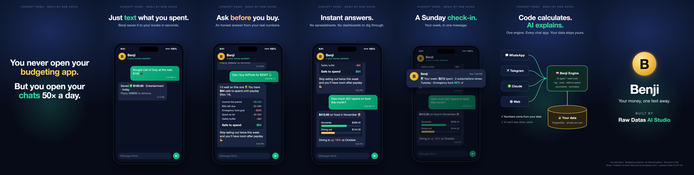

<p align="center">
  
</p>

<h1 align="center">Benji</h1>
<p align="center"><b>Your money, one text away.</b><br>
A personal finance assistant you chat with on WhatsApp, Telegram, Claude or the web.<br>
By <b>Raw Datas AI Studio</b> · built in public 🛠️</p>

---

> **Status: 🚧 Phase 0. Planning and foundations.** Nothing is usable yet.
> Follow the build phase by phase below.

## The problem
People stop tracking their money because tracking is friction: open an app, find the category, type the
amount. So when they wonder *"can I afford this?"*, they guess.

## The idea
Text Benji the way you'd text a friend, in the chat apps you already open 50 times a day.

| You type | Benji does |
|---|---|
| "Bought Call of Duty at the mall, $100" | Saves it: $100 · Entertainment · today (reply UNDO to remove) |
| "Can I buy AirPods for $250?" | *"I'd wait. You have $64 safe to spend until payday on Nov 14."* with the breakdown |
| "How much did I spend on food this month?" | Answers from your real data |
| (Sunday evening) | A one-message weekly check-in |

<p align="center"><br>
<sub>Concept demo storyboard. The product is being built; this is the target experience.</sub></p>

## User stories
1. *As someone who just bought something,* I want to log it in one message, so tracking takes no effort.
2. *As someone about to buy something,* I want an honest "can I afford this?", so I don't regret it later.
3. *As someone who's curious,* I want to ask about my spending in plain words, so I don't have to dig through dashboards.
4. *As someone who's busy,* I want a short weekly summary, so I stay on track without checking.
5. *As someone who cares about privacy,* I want my data kept private and never shared, so I can trust Benji with my money.

## Architecture (one engine, many doors)
```
WhatsApp ─┐
Telegram ─┤                ┌──────────────────────────┐        ┌─────────────┐
Claude ───┼──► webhook ──► │  Benji Engine            │ ─────► │ PostgreSQL  │
Web ──────┘                │  AI agent + safe tools   │ ◄───── │ (per user)  │
                           └──────────────────────────┘        └─────────────┘
```
**Three rules:**
1. **The database is the truth.** The AI never "remembers" balances; it asks the tools.
2. **Code calculates, AI explains.** "Can I afford it?" is a tested formula; the AI only puts it in words.
3. **The AI can only use our tools.** Each tool works on the current user's data only.

Full design: [docs/ARCHITECTURE.md](docs/ARCHITECTURE.md)

## Roadmap
- [x] **Phase 0**: problem, design, repo foundations
- [ ] **Phase 1**: engine in the terminal (agent tool loop, `log_expense`, `safe_to_spend`, tests)
- [ ] **Phase 2**: first chat door (Telegram / WhatsApp webhook)
- [ ] **Phase 3**: deploy, always on (VPS, Docker, HTTPS, backups)
- [ ] **Phase 4**: friends beta (onboarding, weekly summary, privacy controls)
- [ ] **Phase 5**: more doors (Claude MCP connector, web dashboard, receipt photos)

What I learn along the way: [docs/LEARNING_LOG.md](docs/LEARNING_LOG.md)

## Tech stack
Python · FastAPI · PostgreSQL · Claude API (tool use) · Docker · Telegram & WhatsApp Cloud API · MCP

## What Benji is not
- **Not a bank.** It never moves money and never asks for bank logins.
- **Not a financial advisor.** It gives budgeting guidance, not investment advice.

## License
[MIT](LICENSE) © 2026 Raw Datas AI Studio
